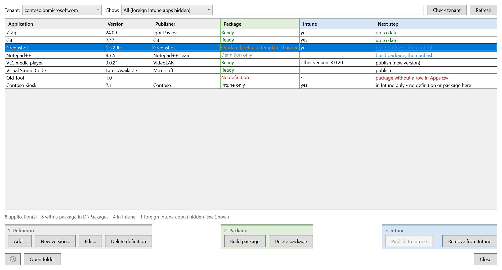
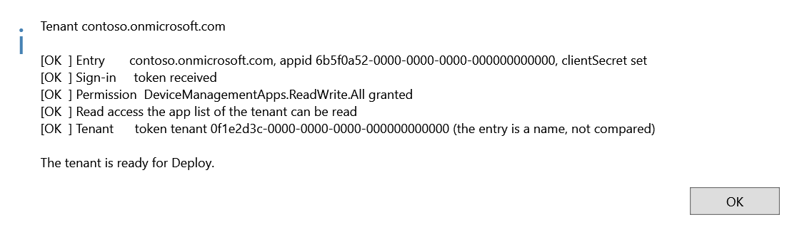
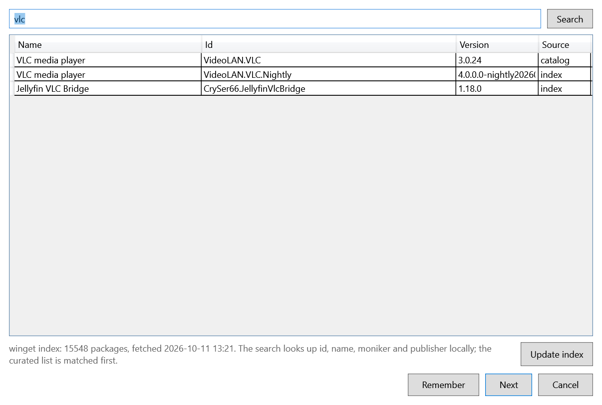

# IntuneWin32Helper
Quickly create and deploy Intune Win32 apps using PSADT. Supports WinGet and mutiple tenants.<br><br>
See https://blog.zarenko.net/intune-apps-verteilen-leicht-gemacht/<br><br>



## The main window

The tool starts with the inventory - there are no start tiles and no separate "create" and "publish"
dialogs any more. One row per app, with the state of the three things that exist per app: **on the
left** the definition and the package, **on the right** the app in the tenant. Everything is done from
that list:

```
Tenant [xyz.onmicrosoft.com v]  Show [All (foreign Intune apps hidden) v]  [Filter...]      [Check tenant] [Refresh]
 Application | Version | Publisher || Package         || Intune  | Next step
 (grey: definition)                 || (green: package) || (blue: tenant)
 1 Definition                          2 Package                            3 Intune
 [Add...] [New version...] [Edit...]   [Build package]                      [Publish to Intune] [Remove from Intune]
 [Delete definition]                   [Delete package]
[gear] [Open folder]                                                                                         [Close]
```

| Column | Meaning |
| --- | --- |
| `Package` | `Definition only`, `Package`, `Package, definition changed` (the package was built before the definition was edited), `Package, built before the definition stamp` (an older package - build it once), `Package, template outdated` / `unstamped`, or `No definition` (a package folder without a row in `Apps.csv`) |
| `Intune` | matched by **name and version**: `yes` is an app with this name and this version; `other version: 1.0.5` means the name exists, this version does not (a publish creates it; the other version stays); `yes (2x)` means the same name **and** version twice (duplicates); `no content` means an entry a failed upload left behind (not published, no committed content); `not checked` when no tenant is connected |
| `Next step` | the sensible next step, derived from the row |

**Apps that only exist in Intune** get a row too (status `Intune only` or `Foreign app`). The tool
writes the note `Created by IntuneWin32Helper <version>` into every app it creates; an app with that
note is *created by this tool* (view *Intune only (created by this tool)*), an app without it is
**foreign** - made by hand, by another tool, or from the Enterprise App Catalog. Foreign apps are
hidden in the default view (the status line says how many); *Foreign apps in Intune* and *Everything,
incl. foreign apps* show them. A foreign app can never be retired from here - that protection sits in
`Get-RetirePlan`, not only in the button. Apps the tool created before it wrote the note, and apps
without a note, show up as foreign.

The tenant is chosen once at the start (not asked at all when only one is configured) and can be
switched in the window; a switch signs in again, because a token that is still valid for the
*previous* tenant would otherwise be reused. Without a tenant the tool keeps working - the Intune
column is simply empty.

**Check tenant** answers "does the app registration have what the tool needs?" before the first deploy
instead of in the middle of it as a 403: it signs in again and reports step by step - the entry in
`config.json` (name, appid as GUID, clientSecret), the sign-in, the permission `DeviceManagementApps.ReadWrite.All`
in the token, whether the app list can really be read, and whether the token belongs to the tenant that is
configured. A failed step skips the ones that build on it. Writing is not tried (that would create an app in the
tenant); the permission is read from the token. After a failed check the previous sign-in stays in effect.



An app has three things - the **definition** (a row in `Apps.csv`), the **package** (the folder with the PSADT
files) and the **app in Intune** - and the buttons follow them, left to right, in three coloured zones that match
the colours of the columns: **1 Definition** (Add / New version / Edit / Delete definition), **2 Package** (Build package, Delete package),
**3 Intune** (Publish to Intune, Remove from Intune). The steps depend on each other from left to right:

- A change on the left makes everything to its right wait. If the package is missing or no longer matches the definition
  or the template (`Definition only`, `Package, definition changed`, `Package, built before the definition stamp`,
  `Package, template outdated` / `unstamped`), **Build package** is the only button right of the definition that works;
  **Publish to Intune** is greyed out.
- Once the package is built, **Build package** is greyed out and **Publish to Intune** is the next step. When the app in Intune
  is already up to date, Publish is greyed out too.
- **Deleting does not wait for anything.** What exists can always be deleted, whatever the state of the others: **Delete definition**
  as soon as there is a definition, **Delete package** as soon as there is a package folder, **Remove from Intune** as soon as the app
  is in Intune (and was created by this tool). A button for a thing that is not there is greyed out.

Greyed-out buttons say why in their tooltip. The rule is one function (`Get-InventoryActionState`, with `Get-BuildTargets`
choosing the rows to build) with a test that lists every state, and a check that the window has no rule of its own.
**Publish never builds or renews a package** - that is Build package, always.

| What you want | What you do |
| --- | --- |
| **A new app** | **Add...** (the editor offers WinGet, MSI and *From installer...*), **Build package**, **Publish to Intune** |
| **A new version** of an app (another version number, the old one goes away) | **New version...**, put the installer into `Files\`, **Build package**, **Publish to Intune**; then select the old version and **Remove from Intune**. The two versions are two apps in Intune; assignments are not carried over |
| **The same version, brought up to date** (the definition was edited, an older package, a new template) | **Edit...** the definition if needed, **Build package**, **Publish to Intune** - the app in Intune is updated in place and its assignments stay |
| **Take an app out** | **Remove from Intune** (asks first; definition and package stay) |
| **Tidy up** | **Delete definition** (the row only), **Delete package** (the package folder, with or without a row) |

| Button | Possible when |
| --- | --- |
| **Edit...**, **New version...** | exactly one row with a definition is selected |
| **Delete definition** | the selection has a row with a definition |
| **Build package** | a selected row has a definition and its package is missing or no longer matches the definition or the template |
| **Publish to Intune** | a selected row can be published: its package matches the definition and the template (or it is a package without a definition), the app is not in Intune twice, has no empty entry there and is not already up to date |
| **Delete package** | a selected row has a package folder |
| **Remove from Intune** | an app of this name **and** version is in Intune and was created by this tool |

The row tooltip spells out all three states, and the selection survives every action.

### Remove from Intune: deleting in Intune

It deletes **apps in Intune**, which cannot be undone, so it works in a careful way:

- The ids to delete come from a **fresh read** of the tenant - never from what the window showed -
  and only for apps with the **name and version** of the selected row. Another version of the same app
  is never touched. If a row has duplicates, all of them are named in the question and all are deleted.
- A question lists every app (id, creation date, with/without content, number of assignments - read from Graph, not from the module) and says
  that the apps **and their assignments** are deleted. The default answer is **No**. If the tenant cannot
  be read, nothing happens and nothing is asked.
- The module's `Remove-IntuneWin32App` only *warns* when it fails (it does not throw), so "the command
  ran" does not mean "the app is gone". After deleting, the tool reads the tenant again and reports each
  app as `Removed`, `StillListed` (with the module's warning), `Failed` or `Unverified`.

The definition in `Apps.csv` and the package folder stay, so the app can be published again - without its
assignments. There is no "Rebuild" any more (build, delete, create anew): **Publish to Intune** brings an app up to date
in place and keeps its assignments, so deleting is only for taking an app out.

### Publish decides before it uploads

Earlier the generated `deploy.ps1` created a **new** app on every bulk run, even when the same app in
the same version was already in Intune - every second run made duplicates. Now the tool decides
first, on a fresh read of the tenant (the state shown in the window may be stale), and hands the
decision to `deploy.ps1` (`-Mode New|Update`, `-UpdateAppId`). There is no "how exactly?" question: the state decides.

| In Intune | Plan |
| --- | --- |
| no app with this name and version | **Create** (also when only another version exists - it stays) |
| exactly one app with this name and version, with content | **Update** - the app is brought up to date in place |
| two or more | **Skip** - remove the duplicates first |
| one, but without content (failed upload) | **Skip** - remove the entry first |
| (any) but the package is missing, older than the definition or built from an older template | **Skip** - run *Build package* first |

**Update** replaces what the definition decides: the package content and icon (`Update-IntuneWin32AppPackageFile`),
detection rule, install and uninstall command, publisher and description (`Set-IntuneWin32App`) and the requirement
rule (architecture, minimum OS: a direct Graph PATCH, `Set-TenantAppRequirement`, because the module's
`Set-IntuneWin32App` does not accept the rule its own `New-IntuneWin32AppRequirementRule` builds). Name, version and
the **assignments** stay. Field-tested in the test tenant: an app with an "all users / available" assignment, a changed
definition (publisher, minimum OS, interactive) - after one publish publisher, commands and requirement were the new
ones, the assignment was still there, and a second publish brought the old values back.

A dialog shows the plan - what is created, what is updated, what is skipped and why - and asks once: **Yes** or **No**
(nothing happens). Publish does not build and does not renew anything: a row whose package must be built first is
skipped with that reason. If the tenant cannot be read, nothing is published. Running `deploy.ps1` by hand still asks (`-Mode Ask`), as before.

**Does the app in Intune match the definition?** `deploy.ps1` writes the note `Created by IntuneWin32Helper <version>; definition <stamp>`
into the app, when it creates it and when it updates it; the inventory reads it back. Only a matching stamp is `up to date`. An app
without a stamp (made by the old tool or by hand) or with another one shows `publish (updates the app in Intune)`: nobody has
checked that it is what the definition says, and one publish makes it so (assignments stay).

**Does the package match the definition and the template?** `Build-AppPackage` stamps `deploy.ps1` with a short hash over the definition
fields that go into the package and the app (`# ToolDefinitionFingerprint:`); the inventory compares it with the row of
today. `Package, definition changed` means the row was edited after the build. A package built before the stamp existed
shows `Package, built before the definition stamp` - build it once and it is known from then on.

Changing the template changes its fingerprint: existing packages show `Package, template outdated` and need
**Build package** (which rebuilds the whole folder, `deploy.ps1` and `detection.ps1` included) before they can be published.

**Delete package** deletes the package folder of the selected rows - with or without a definition in `Apps.csv`
(a row without one has the status `No definition`, typically what is left after a rename or a deleted definition).
It asks first, listing every folder with its file count and size, and says that the definitions and the apps in Intune
are not touched. The button is only enabled when the selection contains a row with a package, and the deletion
itself (`Remove-AppPackages`) refuses on its own anything the tool did not make: a folder not named
`<Name> - <Version>`, a folder without `deploy.ps1`, and anything outside `packetRoot`. Use *Show: Package without definition* and select all to clean up in
one go.

**WinGet search.** *From WinGet...* in the editor opens a search dialog (pattern from SCCMAppHelper). The front
page is the curated list `Config\catalog.json` (name and `packageId`); the search box looks up package id, name,
moniker and publisher in the official winget index, which the tool keeps in `Config\winget-index\` (one download
of `source.msix` from `cdn.winget.microsoft.com`, about 20 MB, refreshed once a day; the line under the list shows
how many packages it holds and when it was fetched, *Update index* fetches it again). That makes the search a
local query - about 150 ms - and independent of the `Microsoft.WinGet.Client` module; the module is only asked
when the index cannot be fetched or read. *Remember* adds the selected package to `catalog.json`. The index is
read through `winsqlite3.dll`, which ships with Windows 10 / Server 2016 and later; nothing is installed.



**Add, New version and Edit** open one editor. The facts about the row (package folder, template,
Intune state, next step) are read-only at the top; the fields below are grouped (Application, Source,
Installation, Intune), label on the left, field on the right. `Architecture` and `MinimumOS` are lists
filled from the IntuneWin32App module, `Interactive` and `SingleMSI` are check boxes, the commands are
multi-line, and the WinGet fields are only enabled while `Version` is `LatestAvailable`. Under
`ArpName` the editor spells out the search name that detection and uninstall will use; the hints under `Version`,
`MsiProductCode` and `logoURL` follow the value as well. **From installer...** takes an EXE or MSI, recognises the
engine from the file (Inno, NSIS, Burn, InstallShield, 7-Zip, Visual Studio bootstrapper) and fills in the install
and uninstall command with the switches of that engine - the very commands the package build would derive from
`Files\` anyway, now readable and editable before the build. Name, publisher and version come from the file, but only into
empty fields. An engine that is not recognised gets `/S` as a guess, says so in a message and carries the note as a
comment in the command; an MSI is zero-config (`SingleMSI`, no commands). The file name in the command is the name in
`Files\`, so the installer has to go there under that name. OK checks name
and version - also against duplicates - and stays open until they are right. The package name comes
from `DisplayName`; the old `PackageName` column of `Apps.csv` is gone (it was never read) and drops out
of the file the next time the tool saves it.

### Templates stay inside the package

The generated `deploy.ps1` and `detection.ps1` stay **inside** the package on purpose: the package
is then a record of what was actually deployed, a template change cannot silently alter a package
that was already tested. The price is that a template fix does not reach old packages by itself - which is
exactly what the `Package` column makes visible (`template outdated`). `Write-DeployScript` stamps every package with a short hash over the templates
(`# ToolTemplateFingerprint:`), and the inventory compares it against the current state.
`unstamped` means the package predates the stamp.

A package from an older template is not repaired in place and not renewed on publish: **Build package** makes it again from
the definition and the current templates (the stamp covers all of them, so `deploy.ps1` **and** `detection.ps1` come
together). The search name and the WinGet id come from the definition, so nothing has to be carried over. Changes made by
hand inside a package are lost on a build - the tool asks before it replaces a package that exists.

## Configuration

`Config/config.json` holds the tenants (tenant name, app registration id, client secret)
and `packetRoot`. It is **not** version controlled, because the client secret is stored in
clear text. On first start it is created automatically from `Config/config.sample.json`;
fill it in via the gear icon in the main window or by editing the file.

App logos are resolved locally from `Logos\` and normalised to 256x256; nothing is uploaded
anywhere. A format this machine cannot read (webp without a codec, svg) falls back to
`Logos\defaultlogo.png` rather than failing the build.

Which logo a package gets, in this order: a file named exactly like the app (`Logos\<DisplayName>.png`); the
`logoURL` of the row (downloaded once and kept in `Logos\`); a logo with a **related name** - the app name without
a trailing version or `(x64)`, or a logo whose name is a word-prefix of it (`7-Zip.png` for "7-Zip 26.02 (x64
edition)"), the longest wins, a space or underscore is the word boundary so "PDF" never takes "PDF24 Creator"; then
the default logo. An explicit `logoURL` is never replaced by such a guess. The editor says under `logoURL` which logo
an empty field leads to.

The PSADT log of every package goes to `%ProgramData%\Microsoft\IntuneManagementExtension\Logs`, next to the logs
of the Intune Management Extension (`Set-PsadtLogPath` rewrites `Toolkit.LogPath` in the package's `config.psd1`).
If a PSAppDeployToolkit update changes that line, the build warns instead of logging into the wrong folder, and
`Test-LogoAndHints.ps1` fails against the installed template.

## Code layout

`Functions\functions.ps1` is only the **loader**: the start script, `deploy_template.ps1` and every package built
by an earlier version load it, so the name stays. It dot-sources the files that hold the functions, one per task:

| File | Holds |
| --- | --- |
| `core.ps1` | dialog results, `Invoke-IntuneModuleCall`, config and transcript, `Format-ErrorDetail`, `Initialize-IntuneConnection`, `check-prereqs` |
| `dialogs.ps1` | `Show-ConfirmDialog` - every message and question (there is no `MessageBox`) |
| `logo.ps1` | resolving and resizing logos |
| `installer.ps1` | path length, installer engine, install commands, MSI properties |
| `deployscripts.ps1` | template and definition fingerprints, writing `detection.ps1` / `deploy.ps1` (only `Build-AppPackage` calls them), reading package folders |
| `package.ps1` | building packages, removing package folders and orphans |
| `appscsv.ps1` | `Apps.csv` - `Save-AppsCsv` is its only writer |
| `inventory.ps1` | one row per app from definition, package and tenant |
| `intune.ps1` | reading the tenant, the deploy plan, deploying |
| `retire.ps1` | Remove from Intune (internally "retire"): plan, assignments, delete with read-back |
| `mainwindow.ps1` | the main window and its loop |
| `editdialog.ps1`, `searchdialogs.ps1`, `settingsdialogs.ps1` | the other dialogs |
| `wingetindex.ps1`, `tenantcheck.ps1` | the winget index and the tenant check; loaded by the start script |

A new file goes into the loader (or the start script), and a function lives in exactly one file - both are checks.
The tests get single functions out of these files through `Tests\Get-ToolFunctionsAst.ps1`, which reads the
list from the loader.

## Apps.csv

Four columns beyond the obvious ones:

| Column | Empty means |
| --- | --- |
| `Architecture` | `x64` |
| `MinimumOS` | `W10_20H2` |
| `Interactive` | silent install without ServiceUI |
| `ArpName` | the `DisplayName` - the name under which the app appears in *Apps & features* |

Both go into the app's requirement rule, so an ARM64 or x86 app and an app that needs a newer
Windows no longer have to share one hard-coded rule. Values must be ones
`New-IntuneWin32AppRequirementRule` accepts.

`Interactive = true` is for the rare package that must show PSAppDeployToolkit dialogs - for
example "close the running application first". Such a package gets `ServiceUI.exe` and runs
without `-DeployMode Silent`. Everything else installs silently in session 0 and never touches the
user's desktop. The reason for that default: through ServiceUI the setup runs **as SYSTEM in the
user's session**, and a setup that starts its app when it is done (Greenshot does) leaves that app
running as SYSTEM on the user's desktop - observed in the field on 2026-09-28/29. That risk remains
for packages marked `Interactive`.

`ArpName` is the search name for both the script detection and the derived uninstall command.
Both use the **same** rule: an entry whose name *starts with* `ArpName`
(`DisplayName -like "<ArpName>*"` and `Uninstall-ADTApplication -Name '<ArpName>*' -NameMatch
'Wildcard'`). Set it when the Intune name differs from the product's entry in the program list, or
to be more precise - `Git` also matches `GitHub Desktop`, and the uninstall removes **every** match.

`Version = LatestAvailable` marks a WinGet app: the package is a thin wrapper that installs
through `winget` on the endpoint. Its detection checks **both** that the package id is present
and that no upgrade is available - otherwise an outdated version would count as current and the
app would never be renewed. When winget cannot reach its source, the app counts as current, so
an offline device does not loop through reinstalls.

## Third-party components

`ServiceUI.exe` in this folder is a Microsoft component and is **not** covered by this
repository's MIT license - see [THIRD-PARTY-NOTICES.md](THIRD-PARTY-NOTICES.md), which also
records that its redistribution terms have not been established.

## Checks

Before committing, run the structural checks from this folder:

```powershell
.\Tests\Invoke-RepoChecks.ps1
```

They parse every `.ps1` of this tool and fail (exit code 1) on: syntax errors, a missing
UTF-8 BOM, unsuppressed `.Add()` return values (these leak `int` indices into a dialog
result), `Out-GridView`/`ogv` usage, parameters that the called function does not declare,
`break`/`continue` outside a loop of the same function, a `deploy_template.ps1` that no
longer routes tenant selection through `Initialize-IntuneConnection`, config reads that
bypass `Get-ToolConfig` (including a missing `.gitignore` entry for `Config/config.json`),
`Start-Transcript` calls that bypass `Start-ToolTranscript`, syntax Windows PowerShell 5.1
cannot parse (`??`, `?.`, `&&`, `||`, ternary), any upload of logos to a third party, logo
handling outside `Resolve-PackageLogo`, a hard-coded requirement rule, a missing path-length
report, a WinGet detection that does not check for an upgrade, and the main window's wiring:
an old entry point (`createApps`, `deployApps`, the start tiles) coming back, a button whose
action has no branch in `Start-InventoryLoop`, a tenant switch that does not sign in again,
a second writer of `Apps.csv` besides `Save-AppsCsv`, a second place that builds packages
besides `Build-AppPackage`, a deploy that bypasses the plan (`Invoke-PackageDeploy` called without
going through `Invoke-InventoryDeploy`, `deploy.ps1` called without `-Mode` or with `-bulk`, a discarded
update result in the template), or an unguarded delete in Intune (`Remove-IntuneWin32App` outside
`Remove-TenantWin32Apps`, no read-back after deleting, no question before deleting, a question that does
not default to No, the loop deleting directly), a fixed wait or a slow module query
back in the build, a button whose state does not come from `Get-InventoryActionState` (check 46), a `Get-DeployPlan` with a "replace existing?" switch, an update branch in `deploy_template.ps1` that does not also update the detection rule, commands and requirement, or a `Write-DeployScript` call without the right `-DefinitionFingerprint` (check 47), or foreign Intune apps no longer protected from Remove from Intune (or the note that identifies the tool's
own apps no longer written), the WinGet search not loaded at start, an unusable `Config\catalog.json`, the local index
not excluded from git, a `[MessageBox]` anywhere (messages and questions go through `Show-ConfirmDialog`, which UI Automation can operate), a file in `Functions\` that neither the loader nor the start script loads, a function that two files define, a `STATUS.md` that lags behind `RELEASES.md` (every section there with "Nicht belegt" or an open box needs a `Quelle:` line, `Stand:` must not be older than the newest section), text that was read as Windows-1252 and saved again (doubled-up umlauts), or a second place that downloads the index, and a failure in the tenant / build / deploy / delete workflow that prints a bare
`$_.Exception.Message` instead of going through `Format-ErrorDetail` (file and line of the failing call).

Each check corresponds to a bug this tool already had, so re-introducing one turns the
check red.

The behaviour tests in `Tests\Test-*.ps1` run on their own and need no tenant:

| Test | What it proves |
| --- | --- |
| `Test-ErrorDetail.ps1` | an error message carries `(file:line)` of the failing call - also on the real path (the tenant read failing), without a location the message stays as it is |
| `Test-TenantCheck.ps1` | "Check tenant" step by step with sign-in and Graph replaced: all OK; an incomplete entry never tries to sign in; a failing sign-in, a token that only reads, a failing read and a token of another tenant each fail their own step and skip what builds on it; a token without permission claims or no JWT is a remark, not a crash; a failed check restores the previous token |
| `Test-InstallerSuggestion.ps1` | "From installer..." against small files with the marks of Inno, NSIS and Burn: switches and file name in the command, an unknown engine is a marked guess, typed name/publisher/version stay (also with a real version resource), the uninstall search follows DisplayName/ArpName, an MSI is zero-config, and the editor suggests exactly what the package build derives |
| `Test-LogoAndHints.ps1` | logo search by related name (exact, trimmed, word-prefix both ways, longest wins, `PDF` never takes `PDF24 Creator`, `defaultlogo` never a candidate), an explicit URL beats a guess, the live hints of the editor (Version, MsiProductCode, logoURL, ArpName), `Set-PsadtLogPath` (read-only file and folder, BOM kept, pattern missing = `$false`, and the pattern is still in the installed PSAppDeployToolkit template) |
| `Test-WinGetIndex.ps1` | the local winget index with a real (small) SQLite database: update takes `index.db` out of the msix and counts the packages right (a one-row result must not fall apart into its columns), reads the schema as major.minor, a broken download keeps the working index, fetched only when missing or older than a day, search by id / name / moniker / publisher (also one hit, an apostrophe, newest version first, `0.10` before `0.9`), curated hits on top with the version from the index, fallback to the module, writing `catalog.json` |
| `Test-WinGetDialog.ps1` | the search dialog through UI Automation: every control has an AutomationId, the curated list is the front page, Search / Return search, no hits and a failing search are reported, Remember writes the package into `catalog.json` (and says "already there"), Next returns name / id / version / publisher, Cancel nothing |
| `Test-Prereqs.ps1` | `check-prereqs` finds the modules in the module path without the slow `Get-InstalledModule` query, checks once per process (every `deploy.ps1` ran it again), installs only what is missing |
| `Test-IntuneOnly.ps1` | apps only in Intune get a row, the tool note tells "created by this tool" from "foreign" (one note in a duplicate is enough, a note without version counts), a defined app never gets a second row, foreign apps are never planned for Retire |
| `Test-TenantRead.ps1` | the tenant list and the assignment count are read straight from Graph (the module's filtered list lagged behind new apps and its assignment cmdlet missed an "all users" assignment): all pages, Win32 and catalog apps only, an error or a missing token means "not read", not "empty" / "0" |
| `Test-RemoveFromIntune.ps1` | only apps with the row's name **and** version from the fresh tenant are deleted (not another version, not what the window showed), the question names every app and its assignments, "No" and an unreadable tenant delete nothing, a delete that only warns is reported as `StillListed` and not as removed |
| `Test-InventoryActionState.ps1` | which button is possible when, left to right: 20 row and selection states (definition only, package current / changed / unstamped / from an older template, in Intune once / twice / empty / other version / up to date, orphan, only in Intune, foreign app, nothing selected, several rows) with the expected state of all seven buttons - a package that must be built locks everything right of Build package, a current package locks Build package - and a disabled Build, Publish or Remove says why; `Get-BuildTargets` picks only the rows that need a build |
| `Test-DefinitionFingerprint.ps1` | the definition stamp in the package: every field that goes into the package or the app changes it, custom columns, column order, spaces and the spelling of `true` do not, it is written into `deploy.ps1` and read back (an empty or unreplaced stamp reads as unknown, and does not swallow the next line), the inventory says current / changed / unknown / n/a |
| `Test-DeployPlan.ps1` | the plan: Intune is matched by name **and** version, Create/Update/Skip per state (one existing app is updated, no second question), duplicates and empty entries are never replaced, a package that must be built first (missing, older than the definition, from an older template) is skipped (also when the app is in Intune), Publish builds and renews nothing, the decision reaches `deploy.ps1` as `-Mode`, Intune is read fresh before planning, only planned apps are deployed, nothing happens on cancel or an unreadable tenant |
| `Test-MainWindowModel.ps1` | the state of every inventory row, and that `Apps.csv` survives read, save and read again (values, own columns, BOM, header) |
| `Test-MainWindowUi.ps1` | operates the real main window through UI Automation: buttons follow the selected row, the selection survives, the filter narrows, a tenant switch is reported, and the real `Start-InventoryLoop` shows the window again after Refresh and ends on Close. Needs a desktop session - the window flashes briefly |
